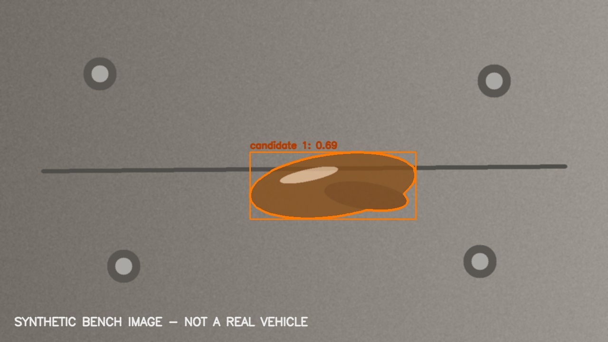

# AutoScan — программный прототип системы осмотра днища автомобиля

AutoScan — ранний программный прототип для проекта мобильной диагностической
тележки. Программа принимает кадр днища неподвижного автомобиля, выделяет
подозрительные влажные или масляные участки, сохраняет размеченное изображение и
формирует машиночитаемый отчёт.

Автор проекта: **Даниялов Мовлет Магомедович**, студент 3 курса ГГНТУ,
направление 09.03.02 «Информационные системы и технологии».

> Текущая версия — проверяемая эвристическая базовая линия на OpenCV, а не
> обученная нейросетевая модель и не готовый диагностический прибор. Она
> подтверждает работоспособность программного конвейера до сбора собственного
> набора данных. Решение механика остаётся обязательным.

## Что уже можно проверить

- обработку одного изображения или папки изображений;
- выделение кандидатов на повторный осмотр;
- формирование маски, диагностической карты и размеченного кадра;
- формирование отчёта `report.json` по стабильной структуре;
- автоматический smoke-тест полного конвейера на синтетическом стендовом кадре.

Синтетический входной кадр:


Результат работы прототипа:



Синтетический пример нужен только для проверки запуска. Он не используется для
расчёта точности и не выдаётся за фотографию реального автомобиля.

## Быстрый запуск

Требования: Python 3.10–3.12.

```powershell
python -m venv .venv
.\.venv\Scripts\Activate.ps1
python -m pip install -r requirements.txt
python create_synthetic_example.py --output examples\synthetic_underbody.png
python autoscan.py --input examples\synthetic_underbody.png --output results --save-debug
```

Проверка версии:

```powershell
python autoscan.py --version
```

Запуск тестов:

```powershell
python -m unittest -v
```

Для собственных фотографий:

```powershell
python autoscan.py --input C:\path\to\photos --output results --save-debug
```

## Выходные данные

В папке результата создаются:

- `*_annotated.jpg` — кадр с выделенными кандидатами;
- `*_mask.png` — бинарная маска подозрительных областей;
- `*_debug.jpg` — диагностическая карта эвристического алгоритма;
- `report.json` — сведения об обработанных кадрах и найденных областях.

Структура отчёта формально описана в
[`docs/report.schema.json`](docs/report.schema.json). Пример результата находится
в [`examples/results/report.json`](examples/results/report.json).

## Как работает текущий алгоритм

1. Кадр нормализуется по освещённости.
2. Вычисляются признаки локального затемнения, насыщенности и тёплого оттенка.
3. Морфологическая обработка удаляет мелкий шум и объединяет связные области.
4. Области фильтруются по площади и ранжируются по внутреннему score.
5. Программа сохраняет визуальный результат и JSON-отчёт.

Score — внутренний показатель базового алгоритма, а не статистически подтверждённая
вероятность утечки.

## Архитектура и план испытаний

- [Техническая архитектура MVP](docs/technical_architecture.md)
- [План проверки MVP](docs/test_plan.md)

Планируемый контур комплекса:

```text
Основная камера -> нормализация -> поиск кандидатов -> проверка механиком
       |                                                   |
       +-----------------> сохранение кадров -------------+
                                                           v
                                                фотоотчёт + PostgreSQL
```

## Что доказано и что ещё предстоит доказать

Доказано текущим репозиторием:

- программный путь «изображение → маска → разметка → JSON-отчёт» запускается;
- входные и выходные данные определены;
- синтетический smoke-тест проверяет сборку и полный путь обработки;
- подготовлены архитектура и программа последующих испытаний.

Пока не доказано:

- точность на реальных автомобилях;
- достижение целевых `precision >= 70%` и `recall >= 75%`;
- устойчивость к пыли, коррозии, теням и защитным покрытиям;
- различение свежего следа жидкости и старого загрязнения;
- характеристики аппаратной тележки до изготовления и стендовых испытаний.

## Ближайшие этапы

- собрать стендовые кадры чистого металла, воды и моторного масла;
- получить разрешённые обезличенные кадры на пилотной площадке;
- разметить данные совместно с механиком;
- сравнить базовую линию OpenCV с компактной моделью сегментации;
- интегрировать камеру, подсветку и привод мобильной платформы;
- провести испытания на время осмотра, автономность и безопасность.

## Ответственное использование

AutoScan не определяет причину неисправности и вид жидкости, не заменяет подъёмник,
осмотр механика или регламентную диагностику. Положительный результат означает
только наличие участка, который специалист должен проверить повторно.

